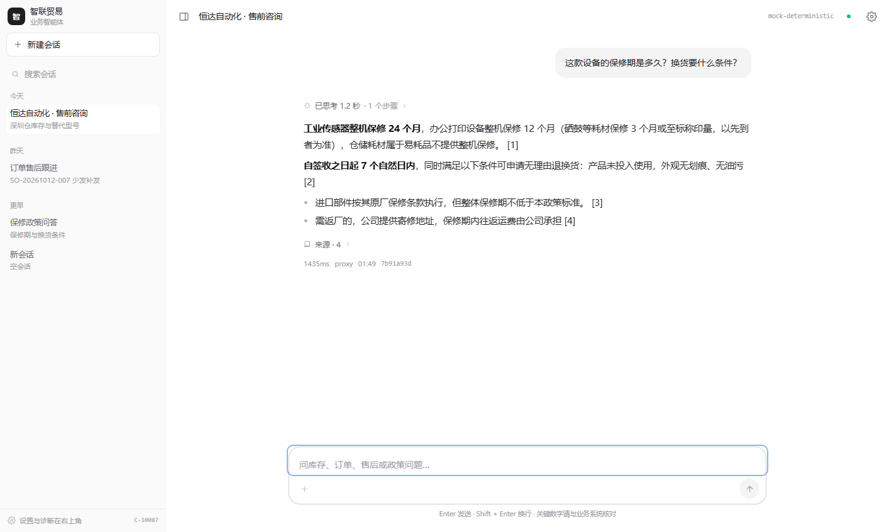
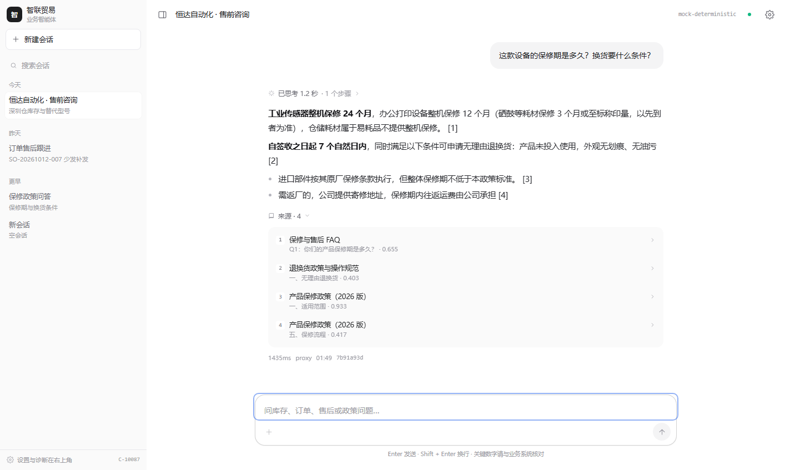
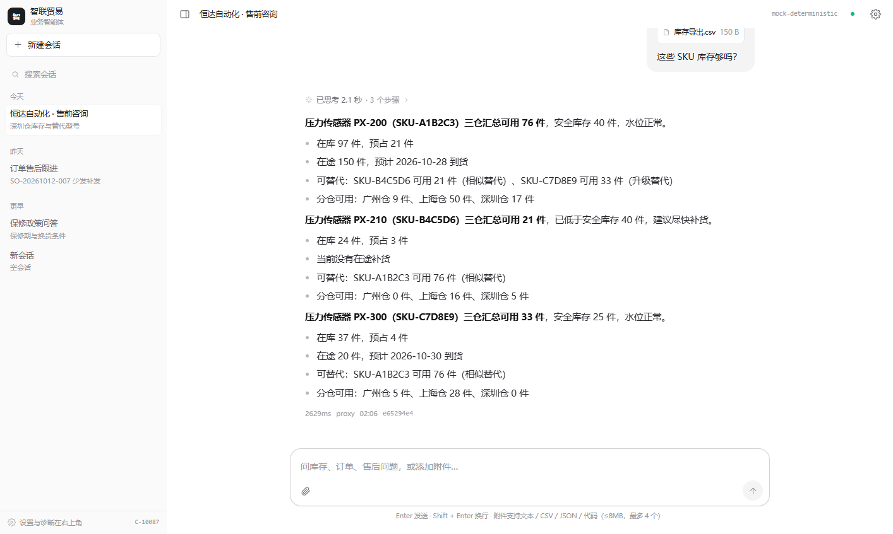
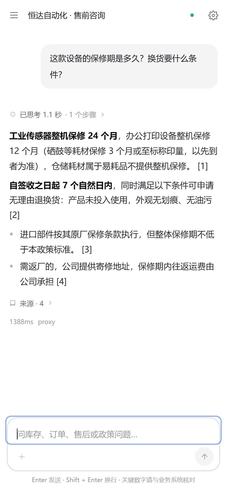

# Web 端改版说明（2026-10-24 · 第二版：浅色极简单列）

> 第一版（2026-10-23）把「技术 Demo」收拾成了「工作台」；这一版把它继续收敛成「对话产品」。
> 功能不减，技术栈不变，改动集中在信息架构、思考过程呈现与回答写法。

## 1. 第一版的问题（来自实际使用反馈）

| 问题 | 具体表现 |
| --- | --- |
| 页面太复杂 | 一屏三栏（264 侧栏 + 正文 + 336 详情面板），顶栏还有服务灯 / 模型 / 链路 / 首包耗时等 5 个 chip |
| 过程信息抢戏 | 工具调用是常驻卡片，再加右侧轨迹页签；一次问答的「工程细节」面积超过答案本身 |
| 回答不像答案 | 知识库回答是检索片段按分数罗列，条数固定 4 条，读到第 4 条才看到真正答案 |
| 长读疲劳 | 全深色界面，正文 14px，密集边框叠阴影 |

一条真实输出（改版前）：

```
根据知识库检索结果：
- 进口部件按其原厂保修条款执行，但整体保修期不低于本政策标准。 [1]
- 自签收之日起 7 个自然日内…可申请无理由退换货 [2]
- 工业传感器整机保修 24 个月… [4]

（以上内容均来自知识库片段，编号对应引用来源。）
```

问「保修期多久」，第一句给的是兜底条款，真正的「24 个月」在最后一行。

## 2. 主流对话产品的共同点

对照 ChatGPT、Claude、DeepSeek、Kimi 的 Web 端，去掉品牌差异后有四条共同做法：

1. **一屏只有三样东西**：会话列表、回答、输入框。配置、诊断、模型切换都在抽屉或二级入口；
2. **过程默认折叠**：思考与工具调用压成一行（「已思考 6 秒」「Thought for 12s」），点开才看细节；
3. **回答结论先行**：第一句直接给答案，后面才是条件与例外；引用是脚注，不是并列面板；
4. **弱化装饰**：浅色底、单一强调色、无气泡堆叠，靠留白和字号建立层级。

## 3. 本次方案

### 3.1 布局：单列 + 可收起侧栏

```
≥1024px   [侧栏 264，可收起] [对话区，正文 760 居中]
<1024px   侧栏变抽屉（汉堡 + 遮罩），对话区单列铺满
```

- 右侧 Inspector 整体移除；
- 顶栏只保留：侧栏开关、会话标题、服务状态点、设置。模型名在宽屏以 10.5px 灰字出现，其余全部下沉；
- 设置抽屉承载链路（direct/proxy）、流式开关、知识库开关、故障注入、运行状态、本地数据清理。

### 3.2 信息分三层

| 层 | 呈现 | 何时出现 |
| --- | --- | --- |
| 答案 | 正文，Markdown，结论加粗 | 始终 |
| 过程 | 一行「已思考 1.2 秒 · 1 个步骤」，点开是灰字思考 + 工具入参/返回 | 默认折叠 |
| 依据 | 一行「来源 · 4」，点开是文档/章节/分数，再点展开原文 | 默认折叠 |

### 3.3 思考过程：流式灰字 → 完成后折叠



- **思考中**：标题「正在思考」+ 呼吸点，下面是模型 `reasoning` 增量的灰字，最大高度 196px、底部渐隐、自动滚到底；
- **首 token 到达**：整块折叠成一行「已思考 X 秒」，答案成为主角；
- **点开**：灰色面板里是完整思考文本 + 每步工具调用（名称、耗时、状态），工具可再展开看入参与返回。

这不是前端伪造的动画：网关新增 `reasoning` SSE 事件，mock 模型按「意图 → 工具选择 → 结果核对」产出确定性思考文本；
接真实推理模型（DeepSeek-R1 / o1 / Claude extended thinking）时，`reasoning_content` 增量会走同一条通道。

### 3.4 回答：结论先行


- 业务工具（库存/订单/工单）：首句给结论并加粗，后面才是明细；
- 知识库：每个意图抽一句「结论句」，加粗首分句；其余片段降级为补充，**单意图最多 1 条补充**；
- 结论句的选择不只看词面重合，还看「像不像答案」：问时效奖励带时间量的句子，问条件奖励条件句，
  对「按原厂执行 / 本政策 / 不低于」这类兜底条款降权 —— 这是「24 个月」能排到第一句的原因；
- 引用编号按正文出现顺序重排，`sources` 只保留正文真正引用到的片段，避免「正文只有 [1]，面板列 4 条」。

改版后同一问题的输出：

```
**工业传感器整机保修 24 个月**，办公打印设备整机保修 12 个月（硒鼓等耗材保修 3 个月或至标称印量），
仓储耗材属于易耗品不提供整机保修。 [1]

**自签收之日起 7 个自然日内**，同时满足以下条件可申请无理由退换货：产品未投入使用，外观无划痕、无油污 [2]

- 需返厂的，公司提供寄修地址，保修期内往返运费由公司承担 [3]
- 产品类别：办公打印设备；整机保修：12 个月；… [4]
```



### 3.5 交互细节

- 空状态：一句问候 + 4 张能力卡（查库存 / 追订单 / 建工单 / 问政策），边界示例降级为两行文字链接；
- 会话标题自动取首条提问（不再永远叫「新会话」）；
- 输入框：Enter 发送、Shift+Enter 换行、IME 组词回车不发送；
- 会话本地持久化沿用上一版（30 会话 / 每会话 80 条 / 流式半截不落盘）；
- 出错时只留一个「重试」，重试复用原用户气泡，不产生重复提问。

### 3.6 视觉令牌

| 令牌 | 值 | 用途 |
| --- | --- | --- |
| `canvas` | `#ffffff` | 主背景 |
| `subtle` | `#fafafa` | 侧栏、折叠面板 |
| `surface` | `#f4f4f5` | 用户气泡、次级按钮 |
| `line` | `#e8e8ec` | 分隔线（唯一描边） |
| `ink` | `#1d1e20` | 主文本、主按钮 |
| `muted` | `#6b6b73` | 次要文本 |
| `faint` | `#9a9aa2` | 元信息 |
| `accent` | `#2563eb` | 链接与焦点环，仅此一处 |

字号阶梯：10.5 / 11.5 / 12.5 / 13.5 / 14.5 / 26–28（标题）；正文行高 1.78。

### 3.7 附件：能读的才收



- 支持 txt / md / CSV / TSV / JSON / 日志 / 配置文件 / 代码，单个 ≤8MB，最多 4 个；
- 支持点击选择、拖拽、粘贴文件；气泡里只显示文件名与大小，**正文不进气泡**；
- 文件正文拼进「发给模型的那条消息」，并作为上下文保留最近两次；更早的折叠成文件名，避免请求体膨胀；
- mock 模式返回「已读取 xxx，共 N 行」+ 前 3 行，不编造结论；接真实模型后由模型理解文件；
- 提问里没有具体型号时，会把附件里的 SKU 各查一次（最多 3 个），而不是只查最后一个；
- PDF / 图片 / Office **明确拒绝并说明原因**，不做「看起来能传、其实答不出」。

## 4. 代码落点

| 文件 | 变更 |
| --- | --- |
| `components/Reasoning.tsx`（新） | 思考流式灰字、折叠行、工具步骤详情 |
| `components/Sources.tsx`（新） | 引用脚注：来源列表 + 原文展开 |
| `components/Inspector.tsx` / `Timeline.tsx` / `Citations.tsx` | 删除（能力合并进上面两个组件） |
| `components/ChatPanel.tsx` | 重写：空态、消息、边界提示、输入区 |
| `components/Header.tsx` / `Sidebar.tsx` | 精简：顶栏只留标题与设置；侧栏可完全收起 |
| `lib/gateway.ts` | 新增 `onReasoning`；非流式消费 `reasoning` 字段 |
| `lib/attachments.ts`（新） | 文本附件读取、限额、拼装成模型消息 |
| `lib/types.ts` / `lib/storage.ts` | `ChatMessage` 增加 `reasoning` / `reasoningMs` / `attachments` / `wireContent` |
| `packages/shared/src/sse.ts` | 新增 `reasoning` 事件（第 10 类事件） |
| `apps/gateway/src/providers/{mock,openai}.ts` | mock 产出确定性思考文本；openai 解析 `reasoning_content` |
| `services/rag/app/{llm,graph}.py` | 结论先行生成、句级答案选择、引用按出现顺序重排 |

## 5. 响应式



- 390×844（2x）实测：侧栏抽屉、正文单列、能力卡单列、输入区在视口内，无横向溢出；
- 滚动超过 24px 时顶栏 52 → 44px，标题字号同步收小；
- 浮层（设置、侧栏）Esc 关闭，遮罩点击关闭。

## 6. 验证

| 项 | 结果 |
| --- | --- |
| `pnpm -r typecheck` | 4 个包通过 |
| `pnpm --filter @app/web build` | 通过（gzip 约 120KB） |
| Node 单测 | 57 条通过（gateway 35 / business 22） |
| Python 单测 | 26 条通过 |
| 端到端 | D1–D8 8/8 |
| RAG 评测 | hit@4 31/31、边界准确率 97.2%、拒答 4/5、平均 41ms |
| 浏览器 | 1440×940 与 390×844 截图核对；思考中 / 折叠 / 展开 / 引用展开均正常 |
| 附件 | 上传 CSV → 气泡显示文件 → 「总结附件」回读 4 行 / 「这些 SKU 库存」触发 3 次工具调用；不支持类型给出红色提示 |

## 7. 取舍与未做

- `sources` 语义变化：从「检索到的片段」改为「正文实际引用的片段」。hit@4 因此改为直接按检索结果计算（更符合指标本意），
  不再拿引用列表当召回率；
- 未做浅色/深色切换：先把浅色做扎实，主题切换需要成套令牌与对比度回归，留到后续；
- 附件只支持文本类：PDF / 图片 / Office 需要服务端解析或视觉模型，当前明确不支持；
  单文件 2 万字符上限、历史只展开最近两次附件，是为了控制请求体与本地存储；
- 会话仍是单浏览器本地存储，跨设备同步需要后端会话表。
